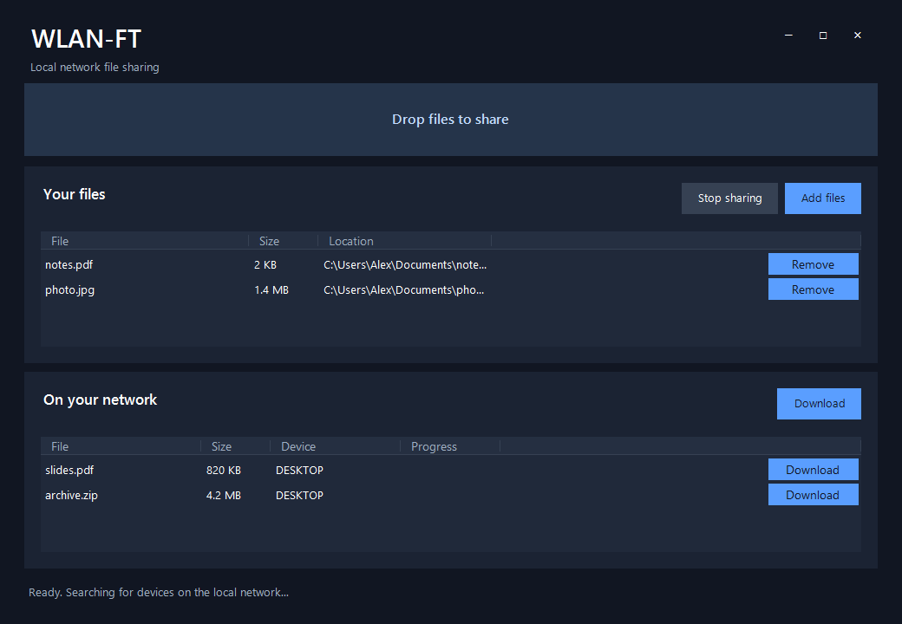

# WLAN-FT

Share files between Windows 10 and 11 computers on the same network, with no accounts or additional installations.



## Usage

1. Download the repository as a ZIP from **Code > Download ZIP** and extract the folder on each computer.
2. Open `Start.vbs` on each computer to launch the app without a console window.
3. If Windows asks about the firewall, allow access on **private networks**.
4. Drag files into the window or use **Add files**.
5. On the other computer, click **Download** next to a file under **On your network**, then choose a destination folder. You can also select a file and use the button above the list.

Keep the application open on the computer sharing the files. To stop sharing, click **Remove** next to a file or select it and click **Stop sharing**. This does not delete the original file. The list refreshes automatically within a few seconds. Individual files can be shared, but not folders.

You can start several downloads individually and run them in parallel. Each file has its own progress bar and **Cancel** button. Two active downloads cannot use the same destination.

Drag the top or title area to move the window. Drag a side, the bottom edge, or a corner to resize it. The buttons in the upper-right corner minimize, maximize, or close the window.

The application uses Windows Script Host, Windows PowerShell 5.1, and the .NET Framework components included with Windows. The launcher allows the script to run in that process without changing the system's execution policy. If Windows Script Host is disabled or startup fails, run the following command from the application folder in Windows PowerShell to see the error:

```powershell
powershell.exe -NoProfile -STA -ExecutionPolicy Bypass -File .\WLAN-FT.ps1
```

The source is organized under `src`: `Models` contains file and peer data, `Views` contains the Windows interface, `Controllers` coordinates user actions, and `Services` handles network discovery and transfers. PowerShell compiles the source files in memory at startup.

## Important

- There is no authentication or encryption: any device on the network that discovers the service can download shared files. Use it only on trusted networks.
- The application does not use Internet servers: it restricts IPv4 connections to the same private or link-local subnet (and the local computer), disables proxies and HTTP redirects, and sends announcements with a one-hop limit. This may prevent it from working on networks with public addresses, VPNs, or different subnets.
- This restriction is part of the application, not a system-wide Windows block. It does not control other programs, system connections, or what other devices on the network do; a separately configured firewall provides additional protection. If you choose files or destinations on network drives or folders, Windows may connect to them: use local paths to avoid this.
- Firewall permission is granted to Windows PowerShell, so it may also affect other scripts run with it. Do not enable public networks.
- If devices do not appear, check that they are on the same private network and that the firewall allows incoming PowerShell connections (UDP 43871 and the dynamic TCP port used by the application). Some Wi-Fi networks isolate devices and prevent them from communicating.
- If you modify a shared file, remove it and add it again before downloading it.
- Downloads are first written to a temporary file in the chosen folder and only replace the destination after completion.

## Tests

Run in Windows PowerShell:

```powershell
powershell.exe -NoProfile -ExecutionPolicy Bypass -File .\tests\WLAN-FT.Tests.ps1
```

## License

This project is licensed under the [MIT License](LICENSE).
